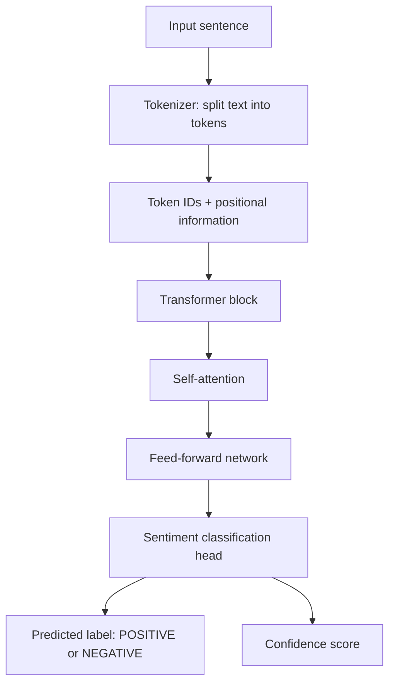

# Task 1: Understand & Visualize — Transformer Architecture

**Student:** Sowmya Y  
**Repository name:** `sowmya-task1`  
**Architecture chosen:** Transformer  
**Hands-on task:** Pretrained sentiment analysis on five sample sentences

## 1. Transformer architecture (explanation)

A Transformer is a neural-network architecture designed to understand relationships between items in a sequence, such as words in a sentence. It was introduced for language tasks and is now used in chatbots, translation, text summarization, and many other AI applications. Unlike a traditional recurrent neural network (RNN), a Transformer does not have to process words strictly one at a time. It can examine relationships between many words in parallel, which helps training run efficiently.

First, the input text is split into smaller pieces called **tokens**. A tokenizer converts these tokens into numerical IDs that a model can process. The model also uses positional information so it can distinguish word order. The numbers are converted into vectors called embeddings.

The key idea is **self-attention**. For each token, self-attention calculates how strongly it should pay attention to other tokens in the sequence. For example, in “The movie was not good,” the word “not” changes the meaning of “good.” Attention helps the model use relevant surrounding words instead of treating every word independently. Transformer blocks also contain feed-forward neural-network layers, residual connections, and normalization layers. These help the model learn useful representations and train reliably.

Many Transformer models are first pretrained on large text collections. They learn general language patterns during pretraining and can then be fine-tuned for a specific task. In this project, we use a pretrained DistilBERT model that has been fine-tuned for sentiment analysis. It classifies a sentence as **POSITIVE** or **NEGATIVE** and returns a confidence score for the predicted class. The program sends five example sentences to the model and prints each input, predicted label, and score.

A pretrained model is useful because we can test a real AI model without collecting a dataset or training a network from scratch. However, its predictions are not guaranteed to be correct. Sarcasm, mixed opinions, unfamiliar topics, and context can confuse sentiment models. The confidence score is the model’s confidence in its chosen label, not proof that the answer is correct. This small experiment demonstrates the basic workflow of using a pretrained Transformer for inference.

## 2. Labelled diagram



## 3. Five inference examples

Run `python inference.py` to get the outputs from the pretrained model. The exact confidence scores are produced at runtime and may differ slightly by software version.

| # | Sample input | Expected sentiment |
|---|---|---|
| 1 | `I absolutely loved this movie. It was wonderful!` | POSITIVE |
| 2 | `This is the worst experience I have ever had.` | NEGATIVE |
| 3 | `The food was delicious and the staff were friendly.` | POSITIVE |
| 4 | `I am disappointed with the poor service.` | NEGATIVE |
| 5 | `The story was interesting and I enjoyed every minute.` | POSITIVE |

### Brief comments on results

The examples include clear positive and negative opinions. The model should usually classify praise and enjoyment as positive, and complaints or disappointment as negative. These examples are intentionally straightforward; real-world sentences may be harder to classify. The program prints the actual predicted label and score, so include its terminal output in your final submission if your instructor expects a saved output report.

## 4. How to run

1. Install Python 3.9 or newer.
2. Open a terminal in this repository folder.
3. Install dependencies:

   ```bash
   pip install -r requirements.txt
   ```

4. Run inference:

   ```bash
   python inference.py
   ```

The first run downloads the pretrained model and requires an internet connection.

## 5. Files in this repository

- `README.md` — architecture explanation, labelled diagram, sample inputs, and comments.
- `inference.py` — runs the pretrained model on five sentences and prints outputs.
- `requirements.txt` — required Python packages.

## 6. Submission checklist

- [ ] Replace `Your Name` with your name.
- [ ] Run the script and check that all five predictions are printed.
- [ ] Upload `README.md`, `inference.py`, and `requirements.txt` to a GitHub repository named `yourname-task1`.
- [ ] Make the repository accessible to your instructor.
- [ ] Copy the repository URL into the Task 1 field in the Student LMS before the deadline.
